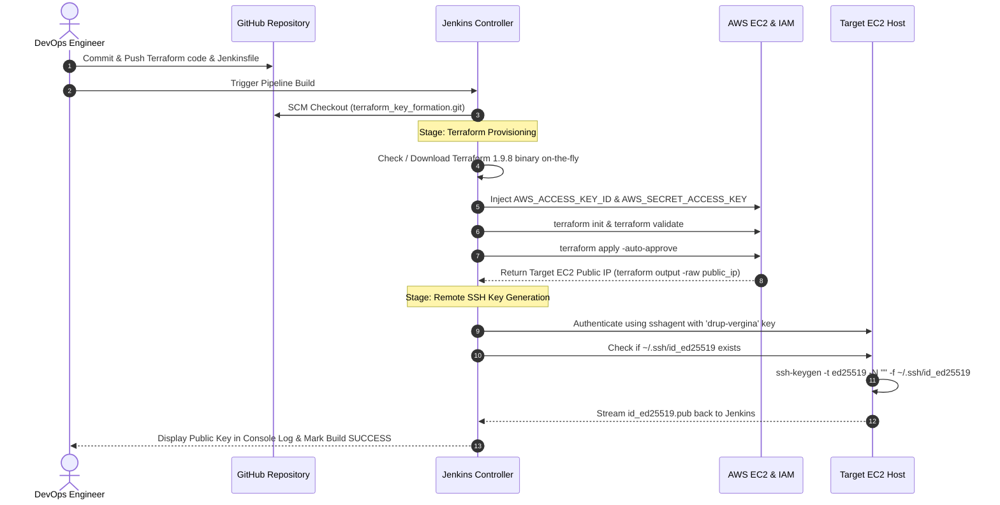

# CloudKey-Ops: Automated AWS Infrastructure Provisioning & Remote SSH Key Lifecycle Pipeline

[](https://www.terraform.io/)
[](https://www.jenkins.io/)
[](https://aws.amazon.com/)
[](https://git-scm.com/)
[](https://en.wikipedia.org/wiki/EdDSA)

---

## 📌 Executive Summary

**CloudKey-Ops** is an automated Infrastructure as Code (IaC) and CI/CD automation project. It demonstrates how a centralized **Jenkins CI/CD controller** seamlessly orchestrates **Terraform** to provision AWS cloud resources (EC2 instance and custom Security Groups) and subsequently automates **remote SSH key generation (Ed25519)** inside the newly created target host via secure Jenkins SSH Agent credentials.

This project bridges the gap between infrastructure provisioning and post-boot host configuration without requiring heavy configuration management agents, maintaining security, idempotency, and automated credential injection.

---

## 🏗️ Architecture & High-Level Design

```mermaid
flowchart TD
    subgraph Developer["Developer Workstation"]
        Dev["Developer"] -->|Push IaC & Pipeline Code| GitHub["GitHub Repository<br/>(terraform_key_formation)"]
    end

    subgraph JenkinsController["AWS EC2 - Jenkins CI/CD Controller"]
        J_Engine["Jenkins Pipeline Engine"]
        J_Creds["Jenkins Credential Store<br/>- AWS Access Key / Secret Key<br/>- SSH Private Key (drup-vergina)"]
        J_Workspace["Pipeline Workspace"]
        
        GitHub -->|SCM Polling / Trigger| J_Engine
        J_Creds -->|Secure In-Memory Injection| J_Engine
        J_Engine -->|Dynamic Download & Install| TF_Binary["Terraform CLI (v1.9.8)"]
    end

    subgraph AWSCloud["AWS Cloud Infrastructure (us-east-1)"]
        subgraph Provisioning["Terraform Execution Phase"]
            TF_Binary -->|1. terraform init / validate| AWS_API["AWS APIs"]
            TF_Binary -->|2. terraform apply| AWS_API
            AWS_API -->|Provisions| SG["AWS Security Group<br/>(Ports 22 & 80)"]
            AWS_API -->|Provisions| EC2_Target["Target AWS EC2 Instance<br/>(new_jenkins_server)"]
            EC2_Target -->|Outputs Public IP| TF_Output["Terraform Output"]
        end

        subgraph KeyGeneration["Remote Configuration Phase (SSH Agent)"]
            TF_Output -->|Export env.EC2_IP| J_Engine
            J_Engine -->|3. ssh-agent ('drup-vergina')| SSH_Auth["SSH Connection (Port 22)"]
            SSH_Auth -->|Execute Remote Command| EC2_Target
            EC2_Target -->|4. Generate Ed25519 Keypair| KeyGen["ssh-keygen -t ed25519 -N ''"]
            KeyGen -->|5. Output Public Key| BuildLog["Jenkins Build Console"]
        end
    end

    classDef primary fill:#2563eb,stroke:#1d4ed8,stroke-width:2px,color:#fff;
    classDef aws fill:#ff9900,stroke:#d97706,stroke-width:2px,color:#000;
    classDef jenkins fill:#d24939,stroke:#b91c1c,stroke-width:2px,color:#fff;
    class Developer primary;
    class JenkinsController jenkins;
    class AWSCloud aws;
```

---

## 🔄 End-to-End Execution Flow



---

## 🌟 Key Features

- **Automated Runtime Dependency Resolution**: The Jenkinsfile dynamically checks for Terraform on the agent host. If absent, it downloads and installs `terraform v1.9.8` automatically inside the workspace `bin` directory without requiring manual root-level package installations.
- **Zero Hardcoded Secrets**: AWS credentials (`AWS_ACCESS_KEY_ID`, `AWS_SECRET_ACCESS_KEY`) and EC2 SSH private keys are managed via the Jenkins Credentials Store and bound dynamically at runtime.
- **Dynamic Infrastructure Handover**: The target EC2 public IP is dynamically queried using `terraform output -raw public_ip` and injected as an environment variable (`env.EC2_IP`) into subsequent pipeline stages.
- **Modern Cryptography (Ed25519)**: Automates generation of `ed25519` SSH keypairs, providing superior security, smaller key footprint, and faster handshake performance compared to legacy RSA keys.
- **Non-Interactive Remote Execution**: Employs `StrictHostKeyChecking=accept-new` to ensure seamless, unattended SSH key verification during first contact.

---

## 📁 Repository Structure

```text
├── Jenkinsfile              # Declarative CI/CD pipeline definition
├── provider.tf              # AWS provider configuration and region definition
├── main.tf                  # Infrastructure resources (EC2 instance & Security Group)
├── variables.tf             # Input variables (AMI, instance type, ports, key name)
├── output.tf                # Outputs public IP address of provisioned instance
├── screenshots/             # Visual proof & step-by-step documentation screenshots
└── README.md                # Comprehensive project documentation
```

---

## ⚙️ Component Breakdown

### 1. Terraform Infrastructure Configuration

#### Provider Configuration (`provider.tf`)
Specifies the AWS target region (`us-east-1`):
```hcl
provider "aws" {
  region = "us-east-1"
}
```

#### Variables (`variables.tf`)
Declares flexible configuration parameters:
- `instance_type`: Default `t3.micro` (AWS Free-Tier eligible).
- `ami`: Default `ami-08c46876c64a927b8` (Amazon Linux 2023 AMI in `us-east-1`).
- `key`: Default `drup-vergina` (pre-created AWS keypair name).
- `port_nu`: Ingress ports list `[22, 80]` for SSH and HTTP access.

#### Core Resources (`main.tf`)
- **Security Group (`sg_key`)**:
  - Inbound rule for Port `22` (SSH) from `0.0.0.0/0`.
  - Inbound rule for Port `80` (HTTP) from `0.0.0.0/0`.
  - Outbound egress: Unrestricted (`-1` protocol, all ports) to `0.0.0.0/0`.
- **EC2 Instance (`new_jenkins_server`)**:
  - Attaches the security group, AMI, instance type, and key pair.

#### Outputs (`output.tf`)
Exposes the public IPv4 address of the created server:
```hcl
output "public_ip" {
  description = "Public IP Address Of The GenKey Server"
  value       = aws_instance.jenkins_server.public_ip
}
```

---

### 2. Jenkins Declarative Pipeline (`Jenkinsfile`)

```groovy
pipeline {
    agent any

    environment {
        AWS_DEFAULT_REGION    = 'us-east-1'
        AWS_CREDS             = credentials('aws-credentials')
        AWS_ACCESS_KEY_ID     = "${AWS_CREDS_USR}"
        AWS_SECRET_ACCESS_KEY = "${AWS_CREDS_PSW}"
        PATH                  = "${env.WORKSPACE}/bin:${env.PATH}"
    }

    stages {
        stage('Terraform') {
            steps {
                sh '''
                    if ! command -v terraform >/dev/null; then
                        mkdir -p bin
                        curl -sSLo tf.zip https://releases.hashicorp.com/terraform/1.9.8/terraform_1.9.8_linux_amd64.zip
                        unzip -o -q tf.zip -d bin && rm tf.zip
                    fi
                    terraform init
                    terraform validate
                    terraform apply -auto-approve
                '''
                script {
                    env.EC2_IP = sh(script: 'terraform output -raw public_ip', returnStdout: true).trim()
                }
                echo "Server IP: ${env.EC2_IP}"
            }
        }

        stage('Generate SSH Key') {
            steps {
                sshagent(['drup-vergina']) {
                    sh '''
                        ssh -o StrictHostKeyChecking=accept-new ec2-user@$EC2_IP '
                            [ -f ~/.ssh/id_ed25519 ] || ssh-keygen -t ed25519 -N "" -f ~/.ssh/id_ed25519
                            cat ~/.ssh/id_ed25519.pub
                        '
                    '''
                }
            }
        }
    }
}
```

---

## 📸 Visual Step-by-Step Implementation Guide & Screenshots

### Phase 1: Jenkins Controller Provisioning & Installation

#### 1.1 Infrastructure as Code for Jenkins Controller Host
The controller host was provisioned using Terraform, declaring the AWS provider, inbound security rules (SSH 22, HTTP 80, Jenkins 8080), and launching the EC2 instance.

| Provider Setup (`provider.tf`) | Variables Configuration (`variable.tf`) |
| :---: | :---: |
|  |  |

| Resource & Security Group (`main.tf`) | Terraform Apply in Terminal |
| :---: | :---: |
|  |  |

#### 1.2 Jenkins Controller EC2 Instance Verification
The `jenkins_master` instance successfully launched in `us-east-1` with public IP `34.238.154.160`.


#### 1.3 Connecting via SSH & Installing Jenkins Dependencies
Connected to `jenkins_master` via SSH, configured hostname, and installed Java 21, Jenkins repo, Git, and dependencies:

```bash
sudo hostnamectl hostname jenkins-master
sudo wget -O /etc/yum.repos.d/jenkins.repo https://pkg.jenkins.io/rpm-stable/jenkins.repo
sudo rpm --import https://pkg.jenkins.io/rpm-stable/jenkins.io-2023.key
sudo dnf install fontconfig java-21 -y
sudo dnf install jenkins git -y
sudo systemctl daemon-reload
sudo systemctl enable --now jenkins
```

| SSH Connection & Package Reference | Command History & Service Start |
| :---: | :---: |
|  |  |

#### 1.4 Jenkins Initial Unlock & Web Setup
Navigated to `http://34.238.154.160:8080`, entered initial administrator password, installed recommended plugins, created admin user, and arrived at the Jenkins dashboard.

| Unlock Jenkins | Install Plugins |
| :---: | :---: |
|  |  |

| Plugins Progress | Jenkins Ready Dashboard |
| :---: | :---: |
|  |  |

---

### Phase 2: AWS IAM User & Jenkins Credentials Setup

#### 2.1 IAM User Access Key Creation
Created IAM user `terraform-user` with necessary EC2 permissions and generated CLI access keys:

| IAM Users Overview | Access Key CLI Option | Retrieve Access Keys |
| :---: | :---: | :---: |
|  |  |  |

#### 2.2 Adding Credentials in Jenkins
Added two global credentials in Jenkins:
1. `AWSCredentials` / `aws-credentials`: AWS Access Key ID & Secret Access Key.
2. `drup-vergina`: SSH Private Key for target EC2 authentication (`ec2-user`).

| Add AWS Credential | Global Credentials Store Configured |
| :---: | :---: |
|  |  |

---

### Phase 3: GitHub SCM & Pipeline Repository Configuration

Created GitHub repository `terraform_key_formation` and pushed Terraform scripts and `Jenkinsfile`:

| Create GitHub Repository | Push Files with Output.tf |
| :---: | :---: |
|  |  |

---

### Phase 4: Jenkins Pipeline Job Creation & Execution

#### 4.1 Creating Pipeline Job & SCM Configuration
Created a new pipeline job named `key_genration` with **Pipeline script from SCM**, specifying the Git repository URL.

| New Item: Pipeline Job | Pipeline SCM Git Configuration |
| :---: | :---: |
|  |  |

#### 4.2 Build Execution & Pipeline Success
Triggered **Build Now**. The pipeline initialized Terraform, provisioned the target instance, captured the public IP, established an SSH connection via `sshagent`, and generated the Ed25519 keypair.

| Pipeline Stages Successful | Console Output: SSH Key Generation |
| :---: | :---: |
|  |  |

---

### Phase 5: Verification & Results

#### 5.1 AWS Console Verification
Both instances running concurrently in AWS EC2:
- `jenkins_master` (`34.238.154.160`): Jenkins CI/CD controller.
- `new_jenkins_server` (`35.173.128.59`): Provisioned target server.


#### 5.2 Target Host SSH Key Verification
Direct verification inside the provisioned instance (`~/.ssh`):
`id_ed25519` and `id_ed25519.pub` were generated seamlessly without manual intervention!


---

## 🔒 Security Best Practices Implemented

1. **Ephemeral Key Injection**: Jenkins `credentials()` and `sshagent()` wrappers inject secrets into environment variables and memory sockets only during execution, avoiding secrets written to disk.
2. **Ed25519 Algorithm**: Employs Edwards-curve Digital Signature Algorithm (`ed25519`), which is cryptographically stronger and immune to timing attacks compared to default 2048-bit RSA.
3. **Idempotent Key Creation**: The conditional check `[ -f ~/.ssh/id_ed25519 ] || ssh-keygen ...` guarantees the key is generated only once, avoiding accidental overwrites during pipeline re-runs.
4. **Host Key Verification**: Used `StrictHostKeyChecking=accept-new` instead of disabling verification entirely (`no`), mitigating Man-in-the-Middle (MITM) risks while permitting automated first-time connections.

---

## 🧹 Infrastructure Cleanup

To prevent unnecessary AWS cloud costs when testing is complete, destroy the provisioned infrastructure:

```bash
# From the Jenkins server or locally with configured AWS credentials:
terraform destroy -auto-approve
```

Alternatively, add an optional `Cleanup` or `Destroy` stage with an approval gate in `Jenkinsfile`.

---

## 👤 Author & Repository

- **Author**: Drup ([@drup987](https://github.com/drup987))
- **Repository**: [https://github.com/drup987/terraform_key_formation.git](https://github.com/drup987/terraform_key_formation.git)
